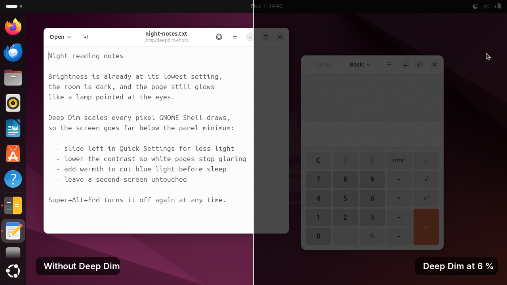
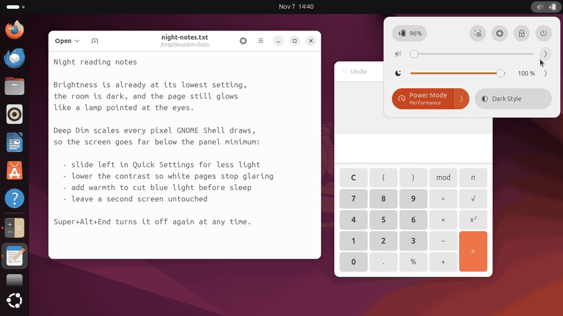
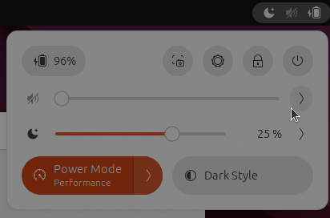
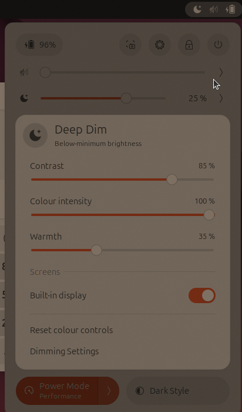
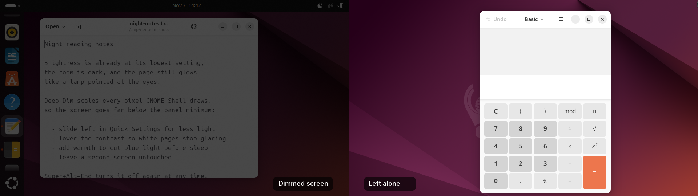
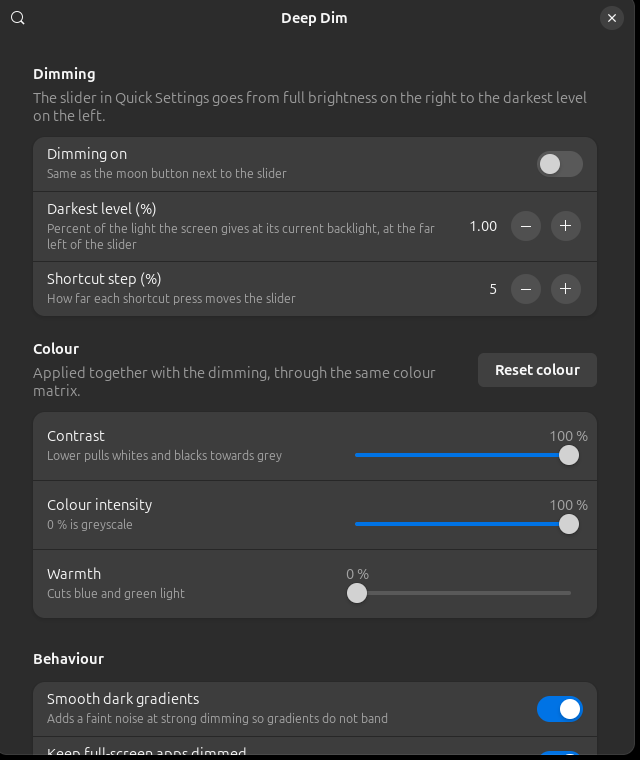

<p align="center">
  
</p>

<h1 align="center">Deep Dim</h1>

<p align="center">
  <strong>Dim your screens below the lowest brightness your hardware allows.</strong><br>
  One slider in Quick Settings, right under the brightness slider, down to almost black.
</p>

<p align="center">
  
  <a href="LICENSE"></a>
  
  
</p>

<p align="center">
  
</p>

---

## Why

You turn the brightness all the way down in a dark room and the screen is
**still too bright**. The panel's lowest backlight step is a hardware limit:
many laptop panels and most external monitors stop well above "comfortable at
2 am". The usual workarounds are half-measures. A dark theme leaves photos,
web pages and video blazing. Night Light shifts colour without removing much
light. A monitor's OSD can't go any lower either.

Deep Dim removes light in software, after the backlight has done all it can.
Every pixel GNOME Shell draws passes through a small colour-matrix shader, so
the screen can go to 10 %, 1 % or less of what the hardware minimum shows. It
works on any screen: laptop panels, HDMI and DisplayPort monitors, projectors.

## What it does

- **Below-minimum dimming**: from full brightness down to 1 % of the light by
  default, configurable down to 0.05 %
- **Lives where brightness lives**: a slider in Quick Settings, placed right
  under the built-in brightness slider (or the ones from
  *Brightness control using ddcutil*), with the remaining light shown as a
  percentage
- **Perceptual slider**: logarithmic like the eye, so every step feels like
  the same change, with fine control at the dark end
- **Contrast, colour intensity and warmth**: lower the contrast so white pages
  stop glaring, desaturate, or cut blue and green light, all in the same
  colour matrix
- **Per-screen control**: dim the laptop and leave the projector alone, with a
  switch for each screen, exact to the pixel at the edge
- **Keyboard shortcuts with on-screen feedback**: step darker and brighter, or
  turn it off, from anywhere, including full-screen apps
- **Lock screen stays dimmed**: unlocking at night doesn't flash full
  brightness
- **Full-screen apps stay dimmed**: games and videos can't bypass the filter
- **Smooth dark gradients**: one level of noise at strong dimming hides
  colour banding
- **Zero cost when off**: the filter is removed entirely, not just made
  transparent

## Demo

<p align="center">
  
</p>

## Screenshots

| Quick Settings | Slider menu |
|:-:|:-:|
|  |  |

| One screen dimmed, the other left alone |
|:-:|
|  |

| Settings |
|:-:|
|  |

## Installation

### From extensions.gnome.org

Coming soon. Once it is published, flip the toggle on its page.

### From source

```bash
git clone https://github.com/joseteo/deepdim.git
cd deepdim
./install.sh
```

`install.sh` copies the extension to
`~/.local/share/gnome-shell/extensions/deepdim@joseteo.github.com`, compiles
its settings schema and enables it. Then restart GNOME Shell:

| Session | Restart method |
|---------|---------------|
| X11 | <kbd>Alt</kbd>+<kbd>F2</kbd> > `r` > <kbd>Enter</kbd> |
| Wayland | Log out and back in |

### From a zip

```bash
./build.sh                     # writes dist/deepdim@joseteo.github.com.shell-extension.zip
gnome-extensions install --force dist/deepdim@joseteo.github.com.shell-extension.zip
```

Restart the Shell as above, then:

```bash
gnome-extensions enable deepdim@joseteo.github.com
```

## Using it

1. Turn the hardware brightness down as far as it goes first. Deep Dim takes
   over from there.
2. Open Quick Settings (top right) and slide the **moon slider** to the left.
   The label shows how much light is left.
3. Click the **moon** to turn dimming off and on again. It remembers the level.
4. Click the **arrow** for contrast, colour intensity, warmth and the screen
   switches.

### Shortcuts

| Action | Default shortcuts |
|--------|-------------------|
| Darker | <kbd>Super</kbd>+<kbd>Alt</kbd>+<kbd>Page Down</kbd>, <kbd>Shift</kbd>+<kbd>Brightness Down</kbd> |
| Brighter | <kbd>Super</kbd>+<kbd>Alt</kbd>+<kbd>Page Up</kbd>, <kbd>Shift</kbd>+<kbd>Brightness Up</kbd> |
| On / off | <kbd>Super</kbd>+<kbd>Alt</kbd>+<kbd>End</kbd> |

They work everywhere: on the desktop, in the overview, in full-screen apps
and on the lock screen. Each press shows the brightness meter with the new
level. You can change them in the settings.

> **Went too dark to see?** Press <kbd>Super</kbd>+<kbd>Alt</kbd>+<kbd>End</kbd>.
> The filter switches off instantly, wherever you are.

### How dark is dark?

The slider is logarithmic. With the default darkest level of 1 %:

| Slider position | Light left |
|:-:|:-:|
| far right | 100 % (filter off) |
| 3/4 | 32 % |
| middle | 10 % |
| 1/4 | 3.2 % |
| far left | 1 % |

These are fractions of the light the screen gives at its current backlight
setting, so Deep Dim stacks on top of the hardware minimum.

## Configuration

Open **Extensions** > **Deep Dim** > **Settings**, choose **Dimming Settings**
in the slider menu, or run:

```bash
gnome-extensions prefs deepdim@joseteo.github.com
```

| Setting | Default | Description |
|---------|---------|-------------|
| Dimming on | off | Same as the moon button |
| Darkest level | 1 % | Light left at the far left of the slider, from 0.05 % to 50 % |
| Shortcut step | 5 % | How far each shortcut press moves the slider |
| Contrast | 100 % | Lower pulls whites and blacks towards grey, down to 30 % |
| Colour intensity | 100 % | 0 % is greyscale |
| Warmth | 0 % | Cuts blue (to 40 %) and green (to 70 %) light, about 2700 K at full |
| Smooth dark gradients | on | One level of noise at strong dimming against banding |
| Keep full-screen apps dimmed | on | Stops full-screen windows from bypassing the compositor while dimming |
| Top bar icon | on | A moon in the top bar while the filter is active |
| Screens | all dimmed | Per-screen switches, in the slider menu |
| Shortcuts | see above | Each one can be changed, disabled or reset |

## Requirements

- **GNOME Shell 46**. Other versions are not claimed in `metadata.json`
  until they are tested.
- X11 or Wayland. It is verified on real hardware under X11, and under
  Mutter's nested Wayland compositor in the automated tests.
- Any GPU that runs GNOME Shell.

## How it works

Deep Dim attaches one `Shell.GLSLEffect` to `Main.layoutManager.uiGroup`, the
actor that holds every window, the panel, the dock, the overview,
notifications and the lock screen. For each pixel `c = (r, g, b)` the
fragment shader computes

```
c' = M · c + offset
```

The 3×3 matrix `M` and the offset are built in
[`lib/colorMatrix.js`](lib/colorMatrix.js) from four controls, in this order:

1. **Colour intensity**: a Rec. 709 saturation matrix,
   `(1 − s)·luma + s·I`.
2. **Contrast**: `k·c + (1 − k)·0.5`, pivoting around mid-grey.
3. **Warmth**: per-channel gains, red unchanged, green down to 70 %, blue
   down to 40 %.
4. **Dimming**: one gain for all three channels.

Pixel values on screen are gamma-encoded, so getting a luminance fraction `L`
takes a gain of `L^(1/2.2)`. The slider position `p` maps to
`L = floor^(1 − p)`, which is why the middle of the slider gives
`sqrt(floor)`.

A few details make this hold up in real use:

- **Multi-monitor correctness.** Mutter paints each monitor as its own stage
  view and culls windows to that view. An offscreen effect normally renders
  once and reuses the texture, so a window spanning two screens would lose
  its second half. Deep Dim re-renders the offscreen texture for each view.
- **Exact per-screen edges.** Skipped screens are tested in the shader
  against the texture coordinate, mapped back to stage pixels through the
  same padded paint box that Clutter renders into. It is refreshed every
  frame, because windows hanging off a screen edge grow that box.
- **Full-screen apps.** While dimming, the Shell is told not to unredirect
  full-screen windows, which would otherwise skip compositing and the filter.
- **No cost when off.** When every control is neutral, or all screens are
  switched off, the effect is removed and unredirection is restored.

## Limitations

- **The mouse pointer is not dimmed.** It is drawn as a hardware cursor plane,
  outside GNOME Shell's rendering.
- **Screenshots and screen recordings** made by GNOME Shell can include the
  dimming.
- **One extra full-screen pass per frame** while dimming. That is negligible
  on any modern GPU, but measurable on battery.
- **8-bit output at very strong dimming** has only a few dozen levels left.
  The dither hides the banding at the cost of a faint grain. You can turn it
  off in the settings.
- **Relative, not absolute.** The darkest level is a fraction of the current
  backlight, not a fixed value in nits.

## Privacy

Deep Dim has no network access and collects nothing. Its only state is its
own GSettings keys under `/org/gnome/shell/extensions/deepdim/`. It reads
monitor names from Mutter's local `org.gnome.Mutter.DisplayConfig` D-Bus
service to label the per-screen switches.

## Development

```
extension.js            lifecycle, settings, shortcuts, full-screen handling
lib/colorMatrix.js      the colour maths (no GNOME imports, unit tested)
lib/dimEffect.js        the GLSL effect and per-screen mapping
lib/monitors.js         screen names and connectors from DisplayConfig
lib/quickSettings.js    slider, menu, top bar icon, placement
prefs/preferences.js    settings window (GTK 4 + libadwaita)
schemas/                settings schema
tests/                  test suites
tools/screenshots.sh    regenerates the images in .github/
```

Three test suites cover it:

```bash
# Colour maths: identity, gamma curve, greyscale, contrast, warmth, ranges
gjs -m tests/test-color-matrix.js

# Settings window: every control writes its key and follows external changes
mkdir -p /tmp/deepdim-schemas && glib-compile-schemas --targetdir=/tmp/deepdim-schemas schemas/
GDK_BACKEND=x11 GSETTINGS_BACKEND=memory gjs -m tests/prefs-smoke.js /tmp/deepdim-schemas /tmp/prefs.png

# End to end, in a throwaway nested GNOME Shell with two screens
tests/nested-test.sh
```

The end-to-end suite starts a nested GNOME Shell with its own temporary
settings, so your session is never touched. It loads a test-only helper
extension from `tests/helper` that allows driving the nested Shell over
D-Bus; never install that helper in a real session. The suite measures the
**real composited pixels** and checks that:

- the dimming ratio matches the maths to within 0.01;
- an excluded screen is untouched to the exact pixel column and row;
- windows spanning two screens or hanging off an edge render correctly;
- greyscale and warmth come out as computed;
- the shortcuts, the moon button and slider dragging work;
- full-screen unredirection is restored;
- the slider sits right after the brightness slider;
- disabling the extension cleans up the effect, slider and shortcuts;
- the lock screen stays dimmed;
- the Shell log has no errors.

It needs an X11 host session, ImageMagick and `xwininfo`.

Before uploading a release to extensions.gnome.org, build the zip and run the
[Shexli](https://pypi.org/project/shexli/) static analyzer on it:

```bash
./build.sh
shexli dist/deepdim@joseteo.github.com.shell-extension.zip
```

## Contributing

Issues and pull requests are welcome. The most valuable contribution is
testing on another GNOME Shell version or GPU and reporting the result,
ideally with the output of `tests/nested-test.sh`.

## Support

If Deep Dim saves your eyes at night, consider buying me a coffee :)

<a href="https://paypal.me/joseteolorente">
  
</a>

## Author

**José Teo Lorente**

- [joseteo.github.io](https://joseteo.github.io)
- [github.com/joseteo](https://github.com/joseteo)

## License

[GPL-2.0-or-later](LICENSE), same family as GNOME Shell itself.
